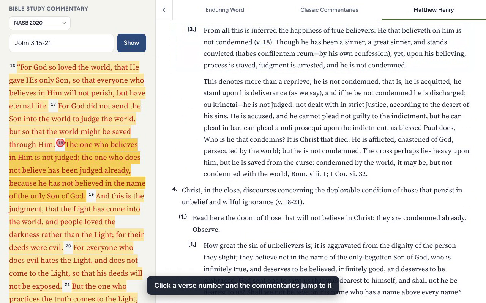
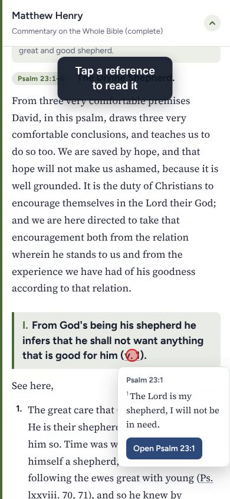

# Bible Study Commentary

A free web app for studying a Bible passage alongside commentaries: Enduring Word (David Guzik), classic
public-domain commentaries (Barnes, Clarke, Jamieson-Fausset-Brown, Poole, Wesley and more) and Matthew
Henry's complete commentary, side by side on desktop and as full-screen pages on phones.

**Open the app:** https://mhelguero.github.io/bible-study/ (it can also be added to a phone's home screen)

## Demo

**Desktop** (1½ minutes): click the picture to watch.

**Phone** (30 seconds)

## What it does

- **Pick a passage** by tapping the search box (Old and New Testament books, then chapter, then verses) or by
  typing it ("John 3:16-21", "Ps 23"). Bookmarks and recent passages are listed there too.
- **Read the whole chapter** with your verses highlighted. Choose NASB 2020, NLT, NIV or Reina-Valera 1909.
- **Commentaries** on the right (desktop) or as their own pages (phone):
  - **Enduring Word** opens at David Guzik's section on your verses.
  - **Classic Commentaries**: Barnes, Clarke, JFB, Poole, Wesley, Matthew Henry Concise, People's New
    Testament, Calvin, Geneva Bible notes and Scofield, showing only the notes on your verses.
  - **Matthew Henry**, laid out as his outline (I. → 1. → (1.) → [1.]).
- **Click a verse number** and the commentaries jump to their notes on that verse.
- **References in the commentaries are links**: hover or tap to read the verse, click to go there.
- **Desktop extras**: drag the divider to resize, slide the passage away, full-screen passage (click a verse to
  open its commentary), and keyboard shortcuts: `/` search, `←` `→` chapter, `1` `2` `3` commentary,
  `F` full screen, `[` hide passage, `+` `−` text size, `B` bookmark.

## Sources and licences

- **Bible text** comes from [API.Bible](https://api.bible) (American Bible Society), one chapter at a time, with
  each translation's copyright notice shown on the page. NASB® © The Lockman Foundation
  ([www.Lockman.org](https://www.lockman.org)); NLT © Tyndale House Foundation; NIV® © Biblica, Inc.;
  Reina-Valera 1909 is public domain.
- **Enduring Word** is embedded from [enduringword.com](https://enduringword.com) (© David Guzik); the app stores
  only an index of its section numbers and verse ranges, not its text.
- **Matthew Henry and the classic commentaries** are public domain, from [CrossWire](https://crosswire.org)
  SWORD modules and the [samueldotj/bible-commentaries](https://github.com/samueldotj/bible-commentaries)
  conversions. `build/` has the scripts that made the data in `data/`.

## Running it yourself

It is a static site: `index.html` plus the files in `data/`, `icons/` and `config.js`.

1. Get a free key at [api.bible](https://api.bible) and put it in `config.js`.
2. Serve the folder, for example `python3 -m http.server 8000`, and open http://localhost:8000.

`index.html` is built from `build/template.html` (with `build/index.json` inlined); `HANDOFF.md` has the
technical notes.
